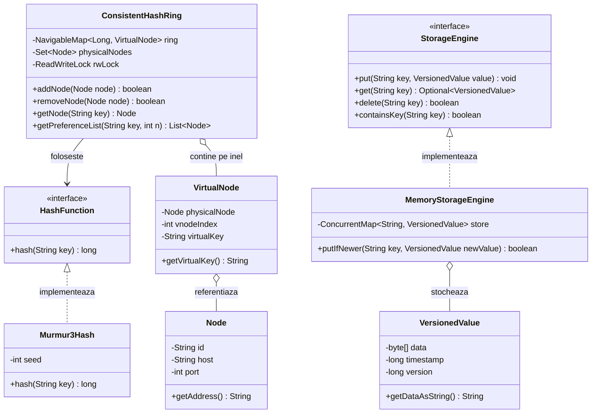
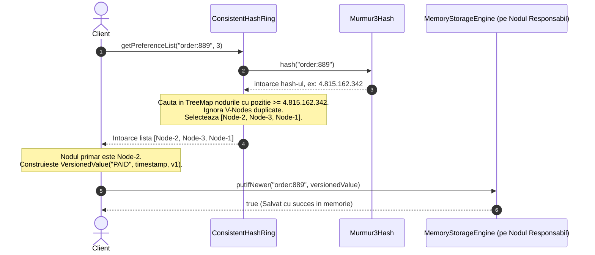

# 📘 Ghid Detaliat al Claselor Implementate în Faza 1
## Core Hashing & Local Storage (Key-Value Store Distribuit)

Acest document explică în profunzime fiecare clasă și interfață dezvoltată în **Faza 1**, rolul său în arhitectura sistemului distribuit, deciziile inginerești din spatele implementării și modul în care aceste componente colaborează.

---

## 🗺️ Harta Conceptuală a Claselor



---

## 1. Pachetul `ro.distributed.kv.core` (Nucleul de Consistent Hashing)

### 1.1. `HashFunction.java` (Interfață Funcțională)
- **Locație:** `src/main/java/ro/distributed/kv/core/HashFunction.java`
- **Rol:** Definește contractul matematic pentru orice funcție capabilă să mapeze un șir de caractere (cheie de date sau identificator de nod) într-un număr întreg pe 64 de biți (`long`).
- **De ce este o interfață separată?**
  - **Decuplare & Testabilitate:** Permite injectarea oricărei funcții de hash. În testele unitare putem folosi funcții mock cu poziții fixe (ex: pentru a forța scenariul de wrap-around), fără a depinde de un algoritm anume.
  - **Annotation `@FunctionalInterface`:** Permite utilizarea funcției ca lambda: `key -> myHash(key)`.

---

### 1.2. `Murmur3Hash.java`
- **Locație:** `src/main/java/ro/distributed/kv/core/Murmur3Hash.java`
- **Rol:** Implementarea concretă de hashing folosită în producție, bazată pe algoritmul **MurmurHash3 (128-bit trunchiat la 64-bit)** via Google Guava.
- **De ce NU folosim `String.hashCode()` din Java?**
  1. `hashCode()` din Java întoarce un număr pe doar 32 de biți (interval de circa 4 miliarde de valori). Pe un inel mare, probabilitatea de coliziune este mult prea mare.
  2. `hashCode()` nu oferă o dispersie uniformă calitativă (*avalanche effect* slab).
- **De ce MurmurHash3 și nu MD5 sau SHA-256?**
  - MD5 și SHA-256 sunt funcții **criptografice**: sunt deliberate lente pentru a rezista atacurilor cibernetice.
  - Consistent Hashing are nevoie de o funcție **non-criptografică ultra-rapidă**, cu dispersie uniformă excelentă pe biți. Murmur3 este de zeci de ori mai rapid decât SHA-256 și consumă mult mai puțin CPU, fiind standardul din Amazon Dynamo și Cassandra.
- **Trunchierea la 64 de biți:** Folosind `Hashing.murmur3_128(seed).hashString(...).asLong()`, obținem un spațiu de $2^{64}$ poziții posibile, eliminând practic riscul de coliziune între noduri.

---

### 1.3. `Node.java`
- **Locație:** `src/main/java/ro/distributed/kv/core/Node.java`
- **Rol:** Reprezintă un **server fizic** din rețea.
- **Proprietăți cheie:**
  - `id` (ex: `"node-1"` sau `"srv-eu-west-1a"`): Identificatorul unic al mașinii în cluster.
  - `host` (ex: `"192.168.1.10"`): Adresa IP sau hostname-ul.
  - `port` (ex: `50051`): Portul pe care rulează serverul gRPC.
- **Decizii de design:**
  - **Imutabilitate:** Câmpurile sunt `final`, garantând că nodul nu se modifică în timp ce este referențiat concurent pe inel.
  - **`equals()` și `hashCode()` bazate strict pe `id`:** Două instanțe de `Node` cu același `id` reprezintă același nod fizic în calculele de apartenență pe inel.

---

### 1.4. `VirtualNode.java`
- **Locație:** `src/main/java/ro/distributed/kv/core/VirtualNode.java`
- **Rol:** Reprezintă o **„clonă virtuală”** a unui nod fizic pe inelul logic.
- **De ce avem nevoie de noduri virtuale (V-Nodes)?**
  - Dacă plasezi doar 3 noduri fizice pe inel, punctele lor pot nimeri întâmplător foarte apropiate (ex: la unghiurile 10°, 20° și 200°). În acest caz, al treilea nod ar primi 80% din tot traficul (*hotspot*).
  - Alocând fiecărui nod fizic 150 de noduri virtuale împrăștiate pe tot inelul, spațiul este divizat în 450 de segmente mici și omogene. Datele se distribuie aproape perfect uniform între servere (așa cum am validat în testul de distribuție: deviație de numai 6.08%).
- **Structura token-ului:**
  - Cheia virtuală este compusă determinist: `nodeId + "#vnode-" + vnodeIndex` (ex: `"node-1#vnode-42"`).
  - Păstrează referința directă către nodul fizic părinte (`physicalNode`).

---

### 1.5. `ConsistentHashRing.java` (Creierul Algoritmului)
- **Locație:** `src/main/java/ro/distributed/kv/core/ConsistentHashRing.java`
- **Rol:** Administrează inelul logic de noduri, rutează cheile către nodul responsabil și furnizează lista de replici unice pentru replicare.

#### Structura internă de date:
```java
private final NavigableMap<Long, VirtualNode> ring = new TreeMap<>();
private final Set<Node> physicalNodes = new HashSet<>();
```
- Folosim un `java.util.TreeMap`, care este un **Red-Black Tree** (arbore binar de căutare echilibrat).
- Căutarea succesorului pe inel are complexitatea de timp $\mathcal{O}(\log K)$, unde $K$ este numărul total de V-nodes (la 5 noduri x 150 vnodes = 750 intrări, căutarea durează sub un microsecundă).

#### Modelul de concurență:
```java
private final ReadWriteLock rwLock = new ReentrantReadWriteLock();
private final Lock readLock = rwLock.readLock();
private final Lock writeLock = rwLock.writeLock();
```
- Operațiunile frecvente (`getNode`, `getPreferenceList`, `isEmpty`) folosesc `readLock`. Mai multe thread-uri pot ruta chei simultan fără să se blocheze reciproc.
- Modificările de topologie (`addNode`, `removeNode`) folosesc `writeLock` exclusiv, garantând consistența inelului în timpul adăugării sau eliminării unui server.

#### Algoritmul `getPreferenceList(String key, int n)`:
Pentru a asigura replicarea (Faza 3), fiecare cheie trebuie salvată pe $N$ noduri fizice diferite:
1. Calculăm `long keyHash = hashFunction.hash(key)`.
2. Cerem sub-arborele ordonat începând de la acest hash: `ring.tailMap(keyHash, true)`.
3. Parcurgem intrările în sensul acelor de ceasornic și extragem `vnode.getPhysicalNode()`.
4. Folosim un `LinkedHashSet<Node>`:
   - **Păstrează ordinea** de întâlnire pe inel.
   - **Deduplică automat:** dacă întâlnim 3 vnodes care aparțin toate de `node-1`, doar prima apariție este reținută!
5. **Wrap-around circular:** Dacă am ajuns la capătul inelului și încă nu am strâns $N$ noduri fizice unice, reluăm parcurgerea de la începutul inelului (`ring.values()`).

---

## 2. Pachetul `ro.distributed.kv.storage` (Motorul de Stocare Locală)

### 2.1. `VersionedValue.java`
- **Locație:** `src/main/java/ro/distributed/kv/storage/VersionedValue.java`
- **Rol:** Încapsulează valoarea stocată pentru o cheie, îmbogățită cu metadate de versionare.
- **Componente:**
  - `byte[] data`: Conținutul binar propriu-zis (indiferent dacă clientul salvează text JSON, imagini sau numere).
  - `long timestamp`: Momentul înregistrării în milisecunde (`System.currentTimeMillis()`), folosit pentru **Last-Write-Wins (LWW)**.
  - `long version`: Număr incremental sau logic utilizat pentru depistarea conflictelor.
- **Siguranță:** Constructorul și getter-ul fac copii defensive (`data.clone()`) pentru a preveni modificarea accidentală a memoriei din exterior.

---

### 2.2. `StorageEngine.java` (Interfață)
- **Locație:** `src/main/java/ro/distributed/kv/storage/StorageEngine.java`
- **Rol:** Definește interfața uniformă a oricărui motor de stocare pe un nod.
- **Metode expuse:**
  - `void put(String key, VersionedValue value)`
  - `Optional<VersionedValue> get(String key)`
  - `boolean delete(String key)`
  - `boolean containsKey(String key)`
  - `int size()`
  - `void clear()`
- **De ce este o interfață?** În Faza 1 folosim stocare în memorie (`MemoryStorageEngine`). În viitor, dacă dorim persistență pe disc (ex: RocksDB sau Append-Only Log / WAL), putem adăuga `DiskStorageEngine` fără a modifica restul sistemului.

---

### 2.3. `MemoryStorageEngine.java`
- **Locație:** `src/main/java/ro/distributed/kv/storage/MemoryStorageEngine.java`
- **Rol:** Motor de stocare în RAM, complet thread-safe și optimizat pentru citiri și scrieri ultra-rapide.
- **Mecanism de stocare:**
  - `ConcurrentMap<String, VersionedValue> store = new ConcurrentHashMap<>();`
  - `ConcurrentHashMap` asigură acces concurent ridicat prin segmentare (*lock striping*) și operațiuni CAS (Compare-And-Swap), fără a bloca întregul tabel la o simplă scriere.
- **Mecanismul Last-Write-Wins (`putIfNewer`):**
  ```java
  public boolean putIfNewer(String key, VersionedValue newValue) {
      return store.compute(key, (k, existing) -> {
          if (existing == null || newValue.getTimestamp() >= existing.getTimestamp()) {
              return newValue;
          }
          return existing; // Ignora scrierea intarziata / invechita
      }) == newValue;
  }
  ```
  - Folosește metoda atomică `compute()`.
  - Garantează că dacă două mesaje de replicare sosesc din rețea în ordine inversată (un update vechi ajunge după unul nou), cel vechi este respins și nu suprascrie datele proaspete.

---

## 3. Scenariu Practic: Cum Colaborează Clasele la un `PUT`

Să urmărim ce se întâmplă pas cu pas în interiorul codului când se dorește salvarea cheii `"order:889"` cu valoarea `"PAID"` într-un cluster cu 3 noduri fizice:



1. **Calculul Poziției:** `ConsistentHashRing` pasează cheia către `Murmur3Hash`.
2. **Căutarea în Inel:** `TreeMap.tailMap()` găsește primele noduri virtuale aflate imediat după hash-ul cheii în sensul acelor de ceasornic.
3. **Deduplicarea:** V-Nodes sunt inspectate, iar nodurile fizice părinte unice sunt adăugate în `preferenceList` (eliminând clonele aceluiași server).
4. **Stocarea Locală:** Nodul ales împachetează valoarea într-un `VersionedValue` cu timestamp-ul curent și o salvează atomic în `MemoryStorageEngine`.

---

## 4. Concluzie

Clasele din Faza 1 formează fundamentul matematic și de stocare al întregului proiect:
- **`ConsistentHashRing`** rezolvă problema distribuției uniforme și a scalării fără invalidare masivă de date.
- **`MemoryStorageEngine`** oferă stocare atomică și pregătește terenul pentru rezolvarea automată a conflictelor de replicare prin versiuni și timestamp-uri.

Aceste componente sunt complet validate prin teste unitare și gata să fie integrate în **Faza 2** cu serverele de rețea gRPC.
