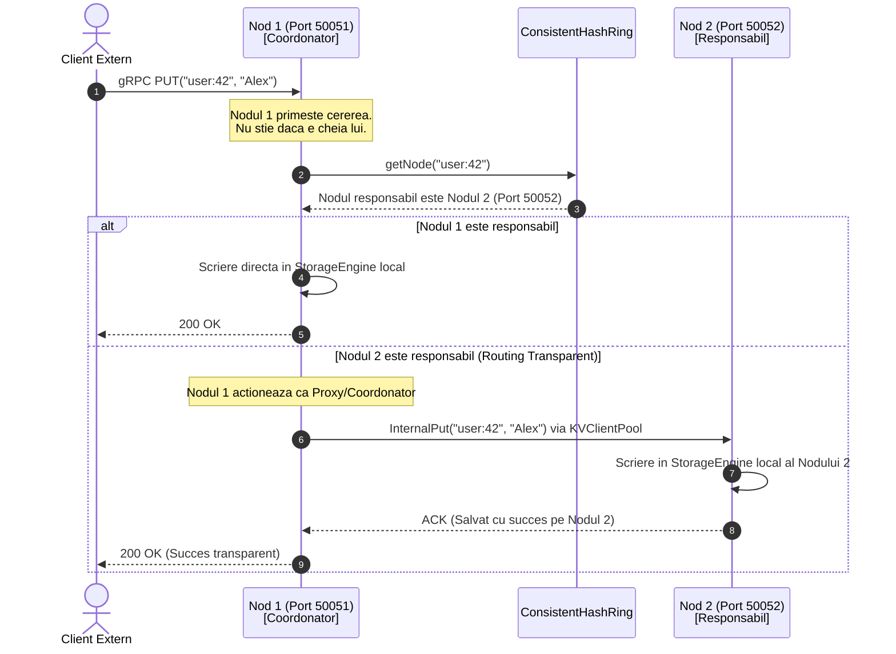

# 🌐 Plan Detaliat de Implementare - Faza 2
## Stratul de Rețea, Comunicație gRPC & Coordonare (Routing Transparent)

---

## 🎯 Obiectivul Fazei 2

În Faza 1 am creat componentele interne (inelul de hashing în memorie și stocarea locală).  
În **Faza 2**, transformăm codul dintr-o simplă librărie într-un **sistem distribuit real**, în care instanțe separate de Java pot rula pe mașini sau porturi diferite, comunicând între ele prin rețea de mare viteză cu **gRPC** și **Protocol Buffers**.

La finalul Fazei 2, oricare nod din rețea va putea primi cereri de la clienți, va acționa ca un **Coordonator / Proxy transparent** și va forwarda cererea către nodul responsabil pe baza inelului de Consistent Hashing.

---

## 🏗️ Arhitectura de Rețea & Fluxul de Date



---

## 📋 Ce vom implementa concret (Pas cu Pas)

### Pasul 1: Configurare Maven & Compilare Protocol Buffers (`pom.xml`)
Adăugăm mecanismul de generare a codului gRPC și protobuf:
- **`os-maven-plugin`**: Detectează arhitectura sistemului de operare (ex: `osx-aarch_64` pentru Mac Apple Silicon).
- **`protobuf-maven-plugin`**: Compilează fișierele `.proto` în clase Java la fiecare `mvn compile`.
- **Dependențe gRPC:**
  - `io.grpc:grpc-netty-shaded` (motorul asincron de rețea Netty integrat).
  - `io.grpc:grpc-protobuf` și `io.grpc:grpc-stub` (stubs de comunicare client/server).
  - `com.google.protobuf:protobuf-java` (serializare binară ultra-rapidă).
  - `jakarta.annotation:jakarta.annotation-api` (necesar pentru codul generat pe Java 21).

---

### Pasul 2: Schema de Comunicație (`src/main/proto/kvstore.proto`)
Definim contractul de rețea strongly-typed:

```protobuf
syntax = "proto3";

package ro.distributed.kv;
option java_multiple_files = true;
option java_package = "ro.distributed.kv.proto";

service KeyValueService {
  // --- 1. API Public pentru Clienti ---
  rpc Get (GetRequest) returns (GetResponse);
  rpc Put (PutRequest) returns (PutResponse);
  rpc Delete (DeleteRequest) returns (DeleteResponse);

  // --- 2. API Intern intre Noduri (Replicare & Forwarding) ---
  rpc InternalGet (InternalGetRequest) returns (InternalGetResponse);
  rpc InternalPut (InternalPutRequest) returns (InternalPutResponse);
  rpc InternalDelete (InternalDeleteRequest) returns (InternalDeleteResponse);
  rpc Heartbeat (HeartbeatRequest) returns (HeartbeatResponse);
}
```

**De ce separăm API-ul Public de cel Intern?**
- `Put` (Public) trece prin algoritmul inelului și este coordonat.
- `InternalPut` este apelat *doar între noduri* când un nod i-a delegat altuia salvarea datelor; acesta scrie direct în `StorageEngine` local, prevenind buclele infinite de forwarding.

---

### Pasul 3: Pool-ul de Conexiuni gRPC (`KVClientPool.java`)
- **Pachet:** `ro.distributed.kv.network`
- **Rol:** Când un nod trebuie să trimită date către un alt nod din cluster, nu vrem să deschidem o conexiune TCP nouă la fiecare cerere (ar fi extrem de lent).
- **Implementare:**
  - Păstrează un cache concurent de `ManagedChannel` (canale gRPC reutilizabile) asociate fiecărui `Node`.
  - Expune stubs gRPC rapide (`KeyValueServiceBlockingStub` și `KeyValueServiceFutureStub`).
  - Gestionează închiderea ordonată a conexiunilor (`close()`).

---

### Pasul 4: Serviciul gRPC și Logica de Coordonare (`KVServiceImpl.java`)
- **Pachet:** `ro.distributed.kv.network`
- **Rol:** Conține logica efectivă de procesare a fiecărui request primit.
- **Logica metodei `put(PutRequest, StreamObserver<PutResponse>)`:**
  1. Extrage cheia și valoarea din request.
  2. Consultă inelul: `Node targetNode = ring.getNode(key);`
  3. **Cazul A (Nodul curent este responsabil):**
     - Împachetează datele în `VersionedValue` și le salvează în `storageEngine.put(...)`.
     - Returnează `PutResponse.newBuilder().setSuccess(true).build()`.
  4. **Cazul B (Alt nod este responsabil - Forwarding):**
     - Obține canalul către `targetNode` din `KVClientPool`.
     - Apelează `internalPut` pe nodul țintă.
     - Trimite răspunsul primit înapoi clientului.
- **Logica metodei `get(GetRequest, StreamObserver<GetResponse>)`:**
  - Analog cu `put`: citește local dacă nodul e responsabil, altfel forwardează către nodul responsabil.
- **Logica apelurilor `internalPut` / `internalGet`:**
  - Execută direct pe `storageEngine` local fără consultarea inelului.

---

### Pasul 5: Serverul de Rețea gRPC (`KVServer.java`)
- **Pachet:** `ro.distributed.kv.network`
- **Rol:** Administrează ciclul de viață al serverului gRPC:
  - `start()`: Leagă portul specificat (`NettyServerBuilder.forPort(...)`), înregistrează `KVServiceImpl` și pornește ascultarea.
  - `stop()`: Închidere elegantă (*graceful shutdown*), așteptând finalizarea cererilor în zbor.
  - `blockUntilShutdown()`: Permite rularea procesului în fundal ca daemon.

---

### Pasul 6: Suita de Teste de Integrare Rețea (`KVNetworkIntegrationTest.java`)
Vom crea un test automat JUnit 5 care pornește **două instanțe reale de server gRPC pe porturi distincte** (ex: `50051` și `50052` pe `localhost`):
1. **Test Forwarding Transparent:**
   - Căutăm o cheie care este alocată de inel pe `Node-2` (port 50052).
   - Trimitem comanda `PUT` către `Node-1` (port 50051).
   - Verificăm că:
     - `Node-1` a forwardat cu succes cererea către `Node-2`.
     - `Node-2` are acum cheia în memoria sa locală.
     - `Node-1` NU are cheia în memoria sa locală (datele nu s-au salvat pe nodul greșit).
2. **Test Citire prin Forwarding:**
   - Cerem cheia de la `Node-1` și verificăm că o returnează corect, deși e stocată pe `Node-2`.
3. **Test Heartbeat:**
   - Verificăm că nodurile răspund la apelul de `heartbeat` între ele.

---

## 📂 Clase Noi create în Faza 2

```text
src/
├── main/
│   ├── proto/
│   │   └── kvstore.proto                         # Contractul gRPC/Protobuf
│   └── java/ro/distributed/kv/
│       └── network/
│           ├── KVClientPool.java                 # Pool de canale gRPC reutilizabile
│           ├── KVServer.java                     # Server gRPC lifecycle
│           └── KVServiceImpl.java                # Logica de rutare/forwarding si procesare
└── test/
    └── java/ro/distributed/kv/network/
        └── KVNetworkIntegrationTest.java         # Test de integrare multi-nod cu forwarding
```

---

## ⚡ De ce este esențială această etapă?
Faza 2 aduce conceptul cheie de **descentralizare**: clientul nu are nevoie să știe topologia inelului sau ce server deține ce cheie. Poate trimite cererea la **oricare server** din cluster, iar clusterul se auto-coordonează intern.

În **Faza 3** (următoarea), vom extinde acest serviciu pentru a trimite cererile nu la 1 singur nod, ci la toate cele $N$ replici responsabile, colectând confirmările conform regulii de **Quorum ($W=2, R=2$)**.
