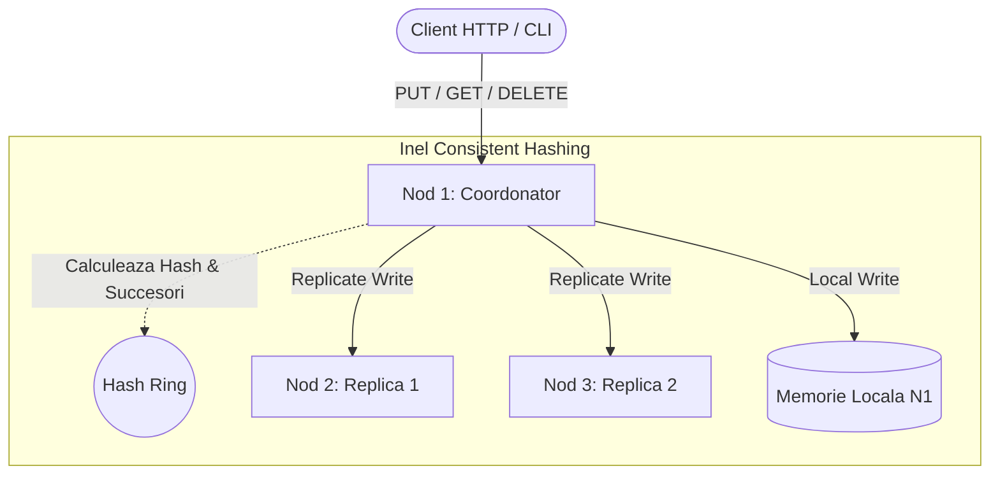
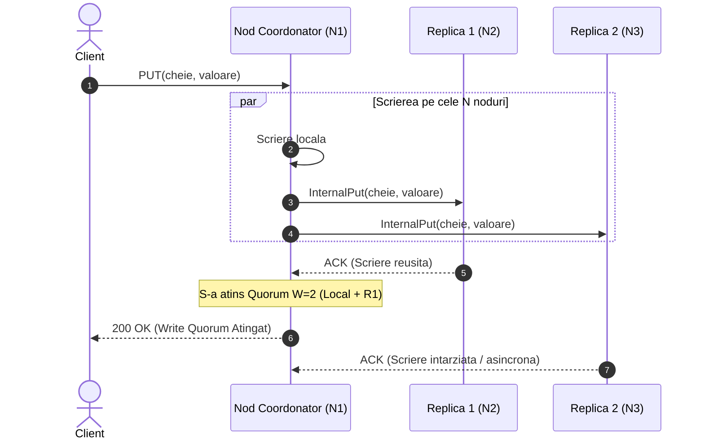

# 🚀 Plan Complet de Implementare: Consistent Hashing Ring (Java)
**Inspirat din arhitecturile Amazon Dynamo & Apache Cassandra**

---

## 📌 Cuprins
1. [Viziune & Arhitectură Generală](#1-viziune--arhitectură-generală)
2. [Stack Tehnologic & Structura Proiectului](#2-stack-tehnologic--structura-proiectului)
3. [Detalierea Fazei 1: Core Hashing & Local Storage (Zilele 1–3)](#3-faza-1-core-hashing--local-storage-zilele-13)
4. [Detalierea Fazei 2: Stratul de Rețea & Routing (Zilele 4–7)](#4-faza-2-stratul-de-rețea--routing-coordonator-zilele-47)
5. [Detalierea Fazei 3: Replicare & Consistență Quorum (Zilele 8–10)](#5-faza-3-replicare--consistență-quorum-zilele-810)
6. [Detalierea Fazei 4: Integrare, Fault Tolerance & Documentație (Zilele 11–14)](#6-faza-4-integrare-fault-tolerance--documentație-zilele-1114)
7. [Checklist de Verificare & Criterii de Succes](#7-checklist-de-verificare--criterii-de-succes)

---

## 1. Viziune & Arhitectură Generală

Proiectul implementează un cluster distribuit de stocare cheie-valoare (**Key-Value Store**) descentralizat, bazat pe:
- **Inel de Consistent Hashing** cu **noduri virtuale (V-Nodes)** pentru distribuție uniformă și evitarea "hotspots".
- **Rol de Coordonator per cerere**: Oricare nod din cluster poate primi o cerere de la client, calculează nodurile responsabile pe inel și acționează ca coordonator pentru acea tranzacție.
- **Replicare pe `N` succesori unici** pe inel (implicit `N = 3`).
- **Consistență configurabilă prin Quorum (`R + W > N`)**:
  - `N` = Factor de replicare (ex: 3)
  - `W` = Număr minim de scrieri confirmate (ex: 2)
  - `R` = Număr minim de citiri congruente (ex: 2)
- **Detecție eșecuri & Heartbeat** pentru eliminarea/ocolirea nodurilor căzute.



---

## 2. Stack Tehnologic & Structura Proiectului

### Tehnologii recomandate
- **Limbaj:** Java 17 sau 21 LTS
- **Build Tool:** Maven (sau Gradle)
- **RPC / Comunicație:** **gRPC** + **Protocol Buffers** (rapid, puternic tipizat, streaming asincron cu Netty) *sau* **Javalin / Netty HTTP** (dacă se dorește o interfață REST pură). *Recomandat: gRPC pentru inter-noduri + opțional server HTTP REST lejer pentru clienți.*
- **Hashing:** `MurmurHash3` (Guava `Hashing.murmur3_128()` sau implementare proprie zero-dependency).
- **Testare:** JUnit 5, AssertJ, Mockito, Testcontainers / Awaitility (pentru teste concurente și asincrone).

### Structura Directoarelor (Maven Multi-Module sau Single-Module bine structurat)

```
kv-consistent-ring/
├── pom.xml
├── README.md
├── scripts/
│   ├── start-cluster.sh        # Porneste 3-5 instante pe porturi distincte
│   └── simulate-failure.sh     # Opreste un nod si valideaza citirea
├── src/
│   ├── main/
│   │   ├── proto/
│   │   │   └── kvstore.proto   # Definitiile gRPC
│   │   ├── java/ro/distributed/kv/
│   │   │   ├── Main.java
│   │   │   ├── config/         # Configurare nod (port, noduri seed, replici, vnodes)
│   │   │   │   └── ClusterConfig.java
│   │   │   ├── core/           # Modelul de date & Hashing
│   │   │   │   ├── HashFunction.java
│   │   │   │   ├── Murmur3Hash.java
│   │   │   │   ├── Node.java
│   │   │   │   ├── VirtualNode.java
│   │   │   │   └── ConsistentHashRing.java
│   │   │   ├── storage/        # Stocare locala in memorie
│   │   │   │   ├── StorageEngine.java
│   │   │   │   ├── MemoryStorageEngine.java
│   │   │   │   └── VersionedValue.java
│   │   │   ├── replication/    # Coordonator Quorum (W, R, N)
│   │   │   │   ├── QuorumCoordinator.java
│   │   │   │   └── ReplicationStrategy.java
│   │   │   ├── network/        # Servere si Clienti gRPC
│   │   │   │   ├── KVServer.java
│   │   │   │   ├── KVClientPool.java
│   │   │   │   └── KVServiceImpl.java
│   │   │   └── cluster/        # Gestiune apartenenta inel & Heartbeat
│   │   │       ├── MembershipManager.java
│   │   │       └── FailureDetector.java
│   └── test/
│       └── java/ro/distributed/kv/
│           ├── core/ConsistentHashRingTest.java
│           ├── storage/MemoryStorageEngineTest.java
│           ├── replication/QuorumReplicationTest.java
│           └── integration/ClusterIntegrationTest.java
```

---

## 3. Faza 1: Core Hashing & Local Storage (Zilele 1–3)

### Obiectiv
Construirea structurilor fundamentale independente de rețea: inelul de hashing cu noduri virtuale și motorul de stocare local cu versionare a cheilor.

### Pasul 1.1: Funcția de Hashing (`HashFunction.java`)
- Se va implementa o interfață `HashFunction`:
  ```java
  public interface HashFunction {
      long hash(String key);
  }
  ```
- Implementare `Murmur3Hash`: MurmurHash3 oferă o distribuție probabilistică uniformă (avalanche effect excelent) și viteză superioară față de MD5/SHA-256.

### Pasul 1.2: Noduri și Noduri Virtuale (`Node.java`, `VirtualNode.java`)
- Fiecare nod fizic are: `id`, `host`, `port`.
- Pentru fiecare nod fizic se generează `V` noduri virtuale (ex: `V = 100 ... 250`):
  - Formula cheie hash: `nodeId + "#vnode-" + i`
  - V-node-ul reține o referință către nodul fizic părinte.

### Pasul 1.3: Inelul de Consistent Hashing (`ConsistentHashRing.java`)
- Folosirea structurii Java `java.util.concurrent.ConcurrentSkipListMap` sau `java.util.TreeMap` cu ReadWriteLock:
  ```java
  private final NavigableMap<Long, VirtualNode> ring = new TreeMap<>();
  ```
- **Adăugare / Ștergere nod:**
  - `addNode(Node node)`: generează hash-urile pentru toți V-nodes și îi introduce în `ring`.
  - `removeNode(Node node)`: curăță intrările corespunzătoare nodului.
- **Ruta unei chei (`getPreferenceList`):**
  - Pentru o cheie dată, se obține hash-ul `h = hash(key)`.
  - Se caută primul nod pe inel: `ring.tailMap(h)` (dacă e gol, wrap-around la `ring.firstEntry()`).
  - **Important:** Se parcurge inelul în sensul acelor de ceasornic pentru a selecta primele `N` **noduri fizice unice** (nu se adaugă duplicate ale aceluiași nod fizic).
- **Teste de validare:**
  - Test de distribuție: adăugare a 5 noduri, inserare 100.000 de chei aleatoare, calcul deviație standard a numărului de chei per nod (trebuie să fie sub 10-15%).

### Pasul 1.4: Motorul de Stocare Locală (`StorageEngine.java`)
- Stocare thread-safe folosind `ConcurrentHashMap<String, VersionedValue>`.
- `VersionedValue`:
  ```java
  public record VersionedValue(byte[] data, long timestamp, long version) {}
  ```
- Operații atomice: `put(key, value)`, `get(key)`, `delete(key)` (suport pentru soft-delete/tombstone sau ștergere directă).

---

## 4. Faza 2: Stratul de Rețea & Routing Coordonator (Zilele 4–7)

### Obiectiv
Permiterea comunicării inter-noduri și expunerea API-ului pentru clienți prin gRPC (sau Netty HTTP). Orice nod devine punct de intrare (Proxy/Coordonator).

### Pasul 2.1: Definirea Contractului gRPC (`kvstore.proto`)
```protobuf
syntax = "proto3";

package ro.distributed.kv;

service KeyValueService {
  rpc Get (GetRequest) returns (GetResponse);
  rpc Put (PutRequest) returns (PutResponse);
  rpc Delete (DeleteRequest) returns (DeleteResponse);
  
  // Apeluri interne intre noduri (replicare)
  rpc InternalPut (InternalPutRequest) returns (InternalPutResponse);
  rpc InternalGet (InternalGetRequest) returns (InternalGetResponse);
  rpc Heartbeat (HeartbeatRequest) returns (HeartbeatResponse);
}

message PutRequest {
  string key = 1;
  bytes value = 2;
}

message PutResponse {
  bool success = 1;
  string message = 2;
}

message GetRequest {
  string key = 1;
}

message GetResponse {
  bool found = 1;
  bytes value = 2;
  int64 timestamp = 3;
}
```

### Pasul 2.2: Serverul gRPC (`KVServer.java`)
- Inițializează `io.grpc.Server` pe portul specificat în configurare.
- Înregistrează serviciul `KVServiceImpl`.

### Pasul 2.3: Pool-ul de Conexiuni (`KVClientPool.java`)
- Păstrează canale gRPC deschise (`ManagedChannel`) reutilizabile către ceilalți membri din cluster.
- Include timeout-uri configurabile (ex: 500ms pentru operațiuni inter-noduri).

### Pasul 2.4: Logica de Coordonare & Forwarding
- Când `Nodul A` primește o cerere `PUT(k, v)` sau `GET(k)`:
  1. Consultă inelul local `ConsistentHashRing.getPreferenceList(k, N)`.
  2. Dacă nodul curent se află în lista primilor `N` succesori: execută operația local și inițiază replicarea pe ceilalți (vezi Faza 3).
  3. Dacă nodul curent **nu** este responsabil de cheie: forwardează cererea direct către primul nod responsabil din listă (Coordonatorul primar) și întoarce răspunsul primit înapoi la client.

---

## 5. Faza 3: Replicare & Consistență Quorum (Zilele 8–10)

### Obiectiv
Implementarea toleranței la căderi prin replicare pe `N` noduri cu politici de consens Quorum (`W + R > N`).

### Pasul 3.1: Politica de Quorum (`QuorumCoordinator.java`)
- Valori implicite: `N = 3`, `W = 2`, `R = 2`.

### Pasul 3.2: Fluxul Quorum Write (`PUT`)
1. Coordonatorul identifică primele `N` noduri unice responsabile pentru `key`.
2. Generează un `timestamp` (ex: `System.currentTimeMillis()`) și un `versionId`.
3. Trimite asincron cererea către toate cele `N` noduri (inclusiv pe sine, prin `storageEngine.put(...)` local dacă este în listă, iar către restul prin `CompletableFuture` cu apel gRPC).
4. Folosește `CompletableFuture.allOf` sau un contor `AtomicInteger` (CountdownLatch):
   - Când primește `W` confirmări de succes înainte de expirarea timeout-ului: întoarce `SUCCESS` la client.
   - Dacă nu se strâng `W` confirmări în intervalul limită (ex: 1 secundă): întoarce `QUORUM_TIMEOUT` / `FAILURE`.

### Pasul 3.3: Fluxul Quorum Read (`GET`) & Conflict Resolution
1. Coordonatorul trimite cereri de citire paralele către `R` (sau toate cele `N`) replici.
2. Așteaptă cel puțin `R` răspunsuri.
3. **Rezolvarea conflictelor (Last-Write-Wins - LWW):**
   - Compară valorile primite pe baza `timestamp`-ului atașat valorii.
   - Valoarea cu cel mai recent timestamp este considerată câștigătoare și trimisă la client.
4. *(Opțional - Read Repair):* Dacă una dintre replici a returnat o valoare mai veche, coordonatorul îi trimite asincron un update în fundal cu valoarea nouă.



---

## 6. Faza 4: Integrare, Fault Tolerance & Documentație (Zilele 11–14)

### Obiectiv
Testarea întregului sistem în condiții reale: pornirea de noduri multiple pe porturi separate, simularea căderii unui nod (`crash fault`), verificarea consistenței și crearea documentației finale.

### Pasul 4.1: Heartbeat & Detecția Nodurilor Căzute (`FailureDetector.java`)
- Fiecare nod rulează un `ScheduledExecutorService` la fiecare 1-2 secunde:
  - Trimite ping către celelalte noduri cunoscute.
  - Dacă un nod nu răspunde la 3 ping-uri consecutive, este marcat ca `SUSPECT` / `DOWN`.
  - Inelul este notificat: nodul `DOWN` este exclus temporar din calculele de preferință sau ocolit în favoarea următorului nod activ (Sloppy Quorum).

### Pasul 4.2: Scripturi de Automatizare a Clusterului
- `scripts/start-cluster.sh`:
  - Pornește 3 instanțe Java în procese de fundal pe porturile `50051`, `50052`, `50053`, cu fișiere de log separate:
    ```bash
    java -jar kv-node.jar --id=node-1 --port=50051 --peers=localhost:50052,localhost:50053 > node1.log 2>&1 &
    java -jar kv-node.jar --id=node-2 --port=50052 --peers=localhost:50051,localhost:50053 > node2.log 2>&1 &
    java -jar kv-node.jar --id=node-3 --port=50053 --peers=localhost:50051,localhost:50052 > node3.log 2>&1 &
    ```
- `scripts/stop-cluster.sh`: Oprește toate procesele asociate.

### Pasul 4.3: Teste de Integrare Automate (`ClusterIntegrationTest.java`)
1. **Test de replicare:** Scriere cheie pe `node-1`, oprire `node-1`, citire aceeași cheie de la `node-2` (trebuie să returneze valoarea corectă).
2. **Test Quorum cu nod căzut:**
   - Cluster de 3 noduri (`N = 3, W = 2, R = 2`).
   - Oprim brusc `node-3` (`kill -9`).
   - Rulăm scrieri pe `node-1`. Deoarece `W = 2` este satisfăcut de `node-1` și `node-2`, scrierile trebuie să continue cu succes.
   - Oprim și `node-2` (rămâne 1 singur nod activ). Scrierile trebuie să eșueze cu `QuorumException` (deoarece `W = 2` nu mai poate fi asigurat).

### Pasul 4.4: CLI Interactiv de Testare (`KVClientCLI.java`)
- O mică aplicație consolă în linie de comandă pentru demonstrații:
  ```text
  kv-cli> connect localhost:50051
  Connected to node-1!
  kv-cli> put user:100 {"name": "Alex"}
  [OK] Stored with Quorum (2/3 ACKs). Responsible nodes: node-1, node-2, node-3
  kv-cli> get user:100
  [FOUND] {"name": "Alex"} (Version: 1716201923)
  kv-cli> ring-status
  Total V-Nodes: 300 | Active Physical Nodes: 3
  ```

### Pasul 4.5: Documentație & README
- Redactare `README.md` profesionist cu:
  - Diagrame de arhitectură (Mermaid).
  - Ghid rapid de rulare (`mvn clean package`, rulare scripturi).
  - Explicația teoretică a deciziilor luate (Trade-offs: De ce MurmurHash3, de ce Last-Write-Wins, Teorema CAP - model AP cu consistență eventuală).

---

## 7. Checklist de Verificare & Criterii de Succes

| Modul / Funcționalitate | Criteriu de Acceptanță | Stare |
|---|---|:---:|
| **Consistent Hash Ring** | Cheile sunt distribuite uniform (deviație standard < 15%) cu V-nodes. | ⬜ |
| **Wrap-around Inel** | Căutarea succesorului funcționează corect la capătul inelului (de la max_hash la min_hash). | ⬜ |
| **Selectare Replici Distincte** | Cei `N` succesori sunt noduri fizice unice, fără duplicate de V-nodes. | ⬜ |
| **Comunicație Rețea** | Servere gRPC capabile să proceseze cereri simultan și să forwardeze mesaje. | ⬜ |
| **Scriere Quorum (`W`)** | Scrierile au succes doar dacă cel puțin `W` noduri confirmă. | ⬜ |
| **Citire Quorum (`R`)** | Citirile returnează cea mai recentă versiune dintre cele `R` răspunsuri (LWW). | ⬜ |
| **Toleranță la Căderi** | Clusterul continuă să răspundă corect la GET/PUT chiar dacă 1 din 3 noduri este oprit forțat. | ⬜ |
| **Rulare Multi-Proces** | 3 noduri pornite pe porturi diferite comunică fără erori de port sau serializare. | ⬜ |
