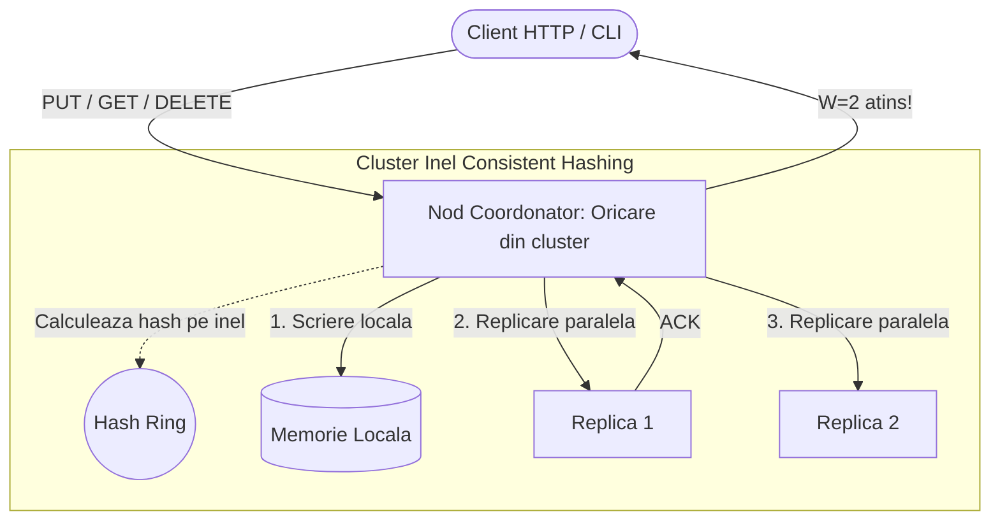

# 📑 Prezentare Generală: Plan de Implementare
## Key-Value Store Distribuit cu Consistent Hashing Ring (Java)
*Arhitectură inspirată din Amazon Dynamo & Apache Cassandra*

---

## 🎯 1. Ce construim? (Viziunea Proiectului)

Un sistem descentralizat de stocare cheie-valoare (**Key-Value Store**) de înaltă disponibilitate, scris în **Java 17/21**, guvernat de trei principii fundamentale:

1. **Fără Single Point of Failure (SPOF):** Orice nod poate primi cereri de la clienți și acționează autonom ca **coordonator** pentru acea operațiune.
2. **Distribuție Uniformă & Scalabilitate:** Datele sunt mapate pe un inel logic continuu prin **MurmurHash3**, utilizând **Noduri Virtuale (V-Nodes)** pentru a preveni supraîncărcarea anumitor mașini (*hotspots*).
3. **Consistență Reglabilă prin Quorum (`R + W > N`):** Datele sunt multi-replicate pe `N = 3` noduri unice fizice, iar operațiunile de citire și scriere necesită confirmarea a cel puțin `W = 2`, respectiv `R = 2` noduri.



---

## 🗓️ 2. Calendarul de Implementare (10–14 Zile)

Proiectul este structurat în **4 etape logice și incrementale**:

```mermaid
gantt
    title Calendar de Dezvoltare (14 Zile)
    dateFormat  X
    axisFormat  Ziua %d
    
    section Faza 1
    Core Hashing & Stocare Locala :active, 1, 3
    
    section Faza 2
    Stratul de Retea & Coordonare (gRPC) : 4, 7
    
    section Faza 3
    Replicare & Consistenta Quorum : 8, 10
    
    section Faza 4
    Integrare, Fault Tolerance & Demo : 11, 14
```



---

### 🔹 Faza 1: Core Hashing & Stocare Locală (Zilele 1–3)
> **Obiectiv:** Implementarea algoritmilor matematici și a stocării în memorie, complet independente de rețea.

- **Funcția de Hashing (`Murmur3Hash.java`):**
  - Implementare pe 64 de biți cu dispersie uniformă și efect de avalanșă.
- **Noduri Fizice & Virtuale (`Node.java`, `VirtualNode.java`):**
  - Fiecărui nod fizic îi alocăm 100–250 de V-Nodes (ex: `server1#vnode-0 ... server1#vnode-149`) pentru echilibrare uniformă a volumului de date.
- **Inelul de Consistent Hashing (`ConsistentHashRing.java`):**
  - Structură de date bazată pe `java.util.TreeMap` (`NavigableMap`).
  - Căutare în sensul acelor de ceasornic în `O(log K)` cu `ring.tailMap()`.
  - Tratarea mecanismului de **wrap-around** (la depășirea celui mai mare hash se revine circular la primul nod).
  - Algoritmul `getPreferenceList(key, N)` care selectează primele `N` **noduri fizice distincte** (fără duplicate).
- **Stocarea Locală (`MemoryStorageEngine.java`):**
  - Stocare thread-safe prin `ConcurrentHashMap<String, VersionedValue>`.
- **Teste Unitare:**
  - Test de distribuție pe 100.000 de chei cu validarea deviației standard (< 15%).

---

### 🔹 Faza 2: Stratul de Rețea & Coordonare (Zilele 4–7)
> **Obiectiv:** Transformarea nodurilor în entități comunicante prin rețea capabile să colaboreze.

- **Definirea Contractului gRPC (`kvstore.proto`):**
  - Operațiuni client: `Get`, `Put`, `Delete`.
  - Operațiuni interne de cluster: `InternalPut`, `InternalGet`, `Heartbeat`.
- **Serverul gRPC (`KVServer.java`):**
  - Server asincron bazat pe Netty pornit pe fiecare instanță.
- **Connection Pooling (`KVClientPool.java`):**
  - Gestionarea conexiunilor refolosibile (`ManagedChannel`) către vecinii din cluster.
- **Pattern-ul de Coordonator:**
  - Când un nod primește o cerere de la client, calculează pe inel cine este responsabil:
    - Dacă este el însuși: execută operația.
    - Dacă este alt nod: forwardează cererea transparent către nodul primar responsabil.

---

### 🔹 Faza 3: Replicare & Consistență Quorum (Zilele 8–10)
> **Obiectiv:** Asigurarea disponibilității și consistenței datelor în prezența nodurilor offline.

- **Politica Quorum:** Implicit `N = 3`, `W = 2`, `R = 2` (`W + R > N`).
- **Scriere Quorum (`PUT`):**
  - Coordonatorul inițiază scrieri asincrone paralele către toate cele 3 replici folosind `CompletableFuture`.
  - Imediat ce cel puțin `W = 2` noduri au confirmat salvarea, clientul primește răspuns de succes.
- **Citire Quorum (`GET`) & Conflict Resolution:**
  - Coordonatorul citește în paralel din `R = 2` replici.
  - **Last-Write-Wins (LWW):** Dacă versiunile diferă, compară timestamp-urile și returnează valoarea cea mai proaspătă.
  - *(Opțional)* **Read Repair:** Actualizează asincron în fundal replica rămasă în urmă.

---

### 🔹 Faza 4: Integrare, Fault Tolerance & Documentație (Zilele 11–14)
> **Obiectiv:** Rularea clusterului multi-proces, testarea căderilor reale și prezentarea proiectului.

- **Detecția Eșecurilor (`FailureDetector.java`):**
  - Heartbeat periodic (la 1–2 secunde); dacă un nod nu răspunde la 3 ping-uri, inelul îl ocolește temporar.
- **Scripturi de Automatizare (`scripts/`):**
  - Lansarea simplă a 3 noduri pe porturile `50051`, `50052`, `50053` prin `start-cluster.sh` și oprirea prin `stop-cluster.sh`.
- **Teste de Cădere Forțată (Chaos / Fault Tolerance):**
  - Scriem date în cluster.
  - Oprim forțat un nod (`kill -9`).
  - Verificăm că operațiile continuă cu succes datorită Quorum-ului (`W=2`, `R=2` asigurate de celelalte 2 noduri).
- **Consolă Interactivă CLI (`KVClientCLI.java`):**
  - Linie de comandă REPL pentru demonstrații live: `put <cheie> <valoare>`, `get <cheie>`, `ring-status`.
- **Documentație Completă:**
  - Diagrame de arhitectură, instrucțiuni de instalare și benchmark de performanță în `README.md`.

---

## 🛠️ 3. Structura Proiectului Java

```text
kv-consistent-ring/
├── pom.xml
├── README.md
├── PLAN_IMPLEMENTARE.md          # Planul tehnic complet
├── PREZENTARE_PLAN.md            # Acest document de sinteza
├── scripts/
│   ├── start-cluster.sh          # Porneste 3 instante locale
│   └── simulate-failure.sh       # Test automat de cadere
└── src/
    ├── main/
    │   ├── proto/kvstore.proto
    │   └── java/ro/distributed/kv/
    │       ├── core/             # Murmur3Hash, Node, VirtualNode, ConsistentHashRing
    │       ├── storage/          # MemoryStorageEngine, VersionedValue
    │       ├── network/          # KVServer, KVClientPool, KVServiceImpl
    │       ├── replication/      # QuorumCoordinator (W, R, N), ReadRepair
    │       └── cluster/          # FailureDetector, Heartbeat
    └── test/                     # Teste unitare si teste de integrare
```

---

## 🏁 4. Cum începem?

Pasul imediat următor este configurarea scheletului de proiect:
1. Generarea fișierului `pom.xml` cu Maven (Java 17+, gRPC, Protobuf, Guava, JUnit 5).
2. Pornirea **Fazei 1**: crearea pachetului `core` (`HashFunction`, `Murmur3Hash`, `Node`, `ConsistentHashRing`).
