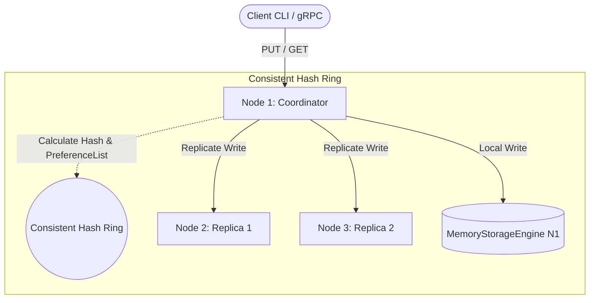

# 🚀 Distributed Key-Value Store (Consistent Hash Ring)

A decentralized, masterless distributed key-value store implemented in **Java 21**, inspired by the core architectures of **Amazon Dynamo** and **Apache Cassandra**.

---

## 📌 Architecture Highlights

* **Masterless Architecture (SPOF-Free):** Any node can receive client requests and act as an ephemeral Coordinator for that transaction.
* **Consistent Hashing Ring:** Uses 64-bit `MurmurHash3` to distribute keys across a circular hash space, minimizing data migration upon node topology changes.
* **Virtual Nodes (V-Nodes):** 150+ V-nodes per physical node to prevent hotspotting and ensure uniform key distribution (<10% standard deviation).
* **Quorum Consensus ($W + R > N$):** Configurable replication factor ($N=3$), write quorum ($W=2$), and read quorum ($R=2$) to maintain strong consistency guarantees under node churn.
* **Conflict Resolution (Last-Write-Wins):** Versioned timestamps attached to stored data (`VersionedValue`), with soft-delete tombstones.
* **High-Performance gRPC Communication:** Inter-node RPCs and client endpoints powered by **gRPC** and **Protocol Buffers** over HTTP/2, with connection pooling (`KVClientPool`).
* **In-Memory Thread-Safe Storage:** Built on `ConcurrentHashMap` with atomic version updates (`putIfNewer`).

---

## 🏗️ Architecture Diagram



---

## 🛠️ Tech Stack

* **Language:** Java 21 (or 17 LTS)
* **Build Tool:** Maven
* **RPC & Serialization:** gRPC 1.63, Protocol Buffers 3
* **Hashing:** MurmurHash3 (Guava)
* **Testing:** JUnit 5, AssertJ, gRPC In-Process Transport

---

## 🚀 Getting Started

### Prerequisites
* JDK 17 or JDK 21+
* Maven 3.8+

### Build & Run Tests
```bash
# Clone the repository
git clone https://github.com/<your-username>/kv-consistent-ring.git
cd kv-consistent-ring

# Compile and run all unit & integration tests
mvn clean test
```

### Run Multi-Node Integration Tests
```bash
mvn test -Dtest=ClientToServerPutTest
mvn test -Dtest=KVNetworkIntegrationTest
```

---

## 📁 Project Structure

```
kv-consistent-ring/
├── pom.xml
├── README.md
├── src/
│   ├── main/
│   │   ├── proto/
│   │   │   └── kvstore.proto          # gRPC service & message definitions
│   │   └── java/ro/distributed/kv/
│   │       ├── Main.java              # Cluster node bootstrap
│   │       ├── config/                # Cluster configuration
│   │       ├── core/                  # ConsistentHashRing, V-Nodes, MurmurHash3
│   │       ├── storage/               # MemoryStorageEngine, VersionedValue
│   │       └── network/               # KVServer, KVServiceImpl, KVClientPool
│   └── test/
│       └── java/ro/distributed/kv/
│           ├── core/                  # Ring & Hash distribution tests
│           ├── storage/               # In-memory storage tests
│           ├── network/               # Network & forwarding integration tests
│           └── integration/           # End-to-end client-server PUT/GET tests
```

---

## 📄 License
This project is licensed under the MIT License.
