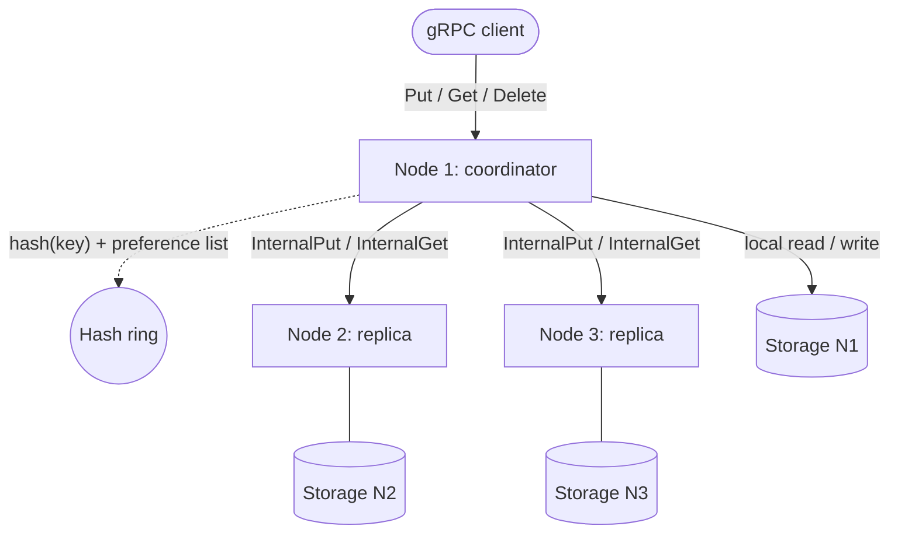

# Distributed Key-Value Store (Consistent Hash Ring)

A decentralized, masterless distributed key-value store written in **Java 21**, inspired by the architectures of **Amazon Dynamo** and **Apache Cassandra**. Nodes talk to each other over **gRPC / Protocol Buffers**; data is partitioned with **consistent hashing** and replicated with **tunable quorums**.

---

## Features

* **Masterless:** every node can receive client requests and acts as the coordinator for that request, so there is no single point of failure.
* **Consistent hashing with virtual nodes:** a 64-bit hash ring (MurmurHash3, 128-bit truncated to 64) with 150 virtual nodes per physical node. Adding or removing a node only remaps the keys adjacent to its virtual nodes. Measured on 100,000 keys over 5 nodes: ~6% coefficient of variation (the test asserts < 15%).
* **Replication on distinct physical nodes:** the preference list walks the ring clockwise (with wrap-around) and skips virtual nodes that belong to a physical node already chosen.
* **Tunable quorums (Dynamo style):** replication factor `N` (default 3), write quorum `W` (2), read quorum `R` (2). With `W + R > N` every read quorum overlaps the latest write quorum.
* **Parallel asynchronous replication:** writes and reads are sent to all replicas in parallel (gRPC future stubs); the coordinator answers as soon as `W` / `R` replicas respond.
* **Fail-fast:** failed replicas are counted; as soon as a quorum can no longer be reached the request fails with `UNAVAILABLE` instead of waiting for the full timeout.
* **Last-Write-Wins conflict resolution:** values carry a timestamp and a version (`VersionedValue`). Ordering is by timestamp, then version, then tombstone.
* **Read repair:** after a read, replicas that returned stale or missing data are updated asynchronously.
* **Deletes as tombstones:** a delete is a quorum write of a tombstone, so a replica that missed the delete cannot bring the key back. Replicas apply writes with an atomic `putIfNewer`, so late or repeated messages never overwrite newer data.
* **Failure detector:** a heartbeat-based detector marks a peer DOWN after consecutive failures and UP again when it answers; DOWN peers are skipped without waiting on the network.
* **Thread safety:** the ring uses a `ReentrantReadWriteLock`; storage is a `ConcurrentHashMap`; gRPC channels are pooled and reused (`KVClientPool`).

### Consistency model

Reads and writes are quorum-based and conflicts are resolved with Last-Write-Wins on wall-clock timestamps. With `W + R > N` a successful read observes the most recent *acknowledged* write, but this is **not** linearizability: concurrent writes are ordered by timestamp, and clock skew between coordinators can reorder them.

---

## Architecture



**Write path (`Put`):** the coordinator computes the preference list of `N` distinct nodes, generates one timestamp/version, writes locally if it is a replica and sends `InternalPut` to the others in parallel, and returns success after `W` acknowledgements.

**Read path (`Get`):** the coordinator queries the replicas, waits for `R` answers, returns the newest value (a winning tombstone means "not found") and repairs stale replicas in the background.

---

## Tech Stack

* **Language:** Java 21
* **Build:** Maven
* **RPC & serialization:** gRPC, Protocol Buffers 3
* **Hashing:** MurmurHash3 (Guava)
* **Testing:** JUnit 5, AssertJ, gRPC in-process transport

---

## Getting Started

### Prerequisites
* JDK 21
* Maven 3.8+

### Build and test
```bash
git clone https://github.com/rarescs23/distributed-kv-store.git
cd distributed-kv-store
mvn clean test
```

The suite includes unit tests (ring, hashing, storage), a 3-node in-process cluster (`QuorumClusterTest`: node failure, read repair, tombstones), the failure detector, and a 3-node cluster over real TCP sockets (`TcpClusterTest`).

### Running a node

Run `ro.distributed.kv.Main` (from your IDE, or from the command line with the project classpath) once per node. Node IDs must be **identical in every node's configuration**, because the hash ring is built from node IDs:

```
# node 1
--id=node-1 --port=50051 --peers=node-2@127.0.0.1:50052,node-3@127.0.0.1:50053
# node 2
--id=node-2 --port=50052 --peers=node-1@127.0.0.1:50051,node-3@127.0.0.1:50053
# node 3
--id=node-3 --port=50053 --peers=node-1@127.0.0.1:50051,node-2@127.0.0.1:50052
```

| Argument | Default | Description |
|---|---|---|
| `--id` | random | Unique node ID (must match what peers use for this node) |
| `--host` | `127.0.0.1` | Host of this node |
| `--port` | `50051` | gRPC port |
| `--peers` | none | Comma-separated `[id@]host:port` (without `id@`, the ID is `host:port`) |
| `--n`, `--w`, `--r` | `3`, `2`, `2` | Replication factor, write quorum, read quorum |

### Talking to the cluster

The API is defined in [`kvstore.proto`](src/main/proto/kvstore.proto) (`Put`, `Get`, `Delete` for clients; `InternalPut`, `InternalGet`, `InternalDelete`, `Heartbeat` between nodes). Any node accepts client requests. For example with [grpcurl](https://github.com/fullstorydev/grpcurl) (bytes fields are base64 in JSON):

```bash
grpcurl -plaintext -import-path src/main/proto -proto kvstore.proto \
  -d '{"key": "user:42", "value": "SW9u"}' \
  localhost:50051 ro.distributed.kv.KeyValueService/Put

grpcurl -plaintext -import-path src/main/proto -proto kvstore.proto \
  -d '{"key": "user:42"}' \
  localhost:50052 ro.distributed.kv.KeyValueService/Get
```

---

## Project Structure

```
src/main/
├── proto/kvstore.proto                   # gRPC service and messages
└── java/ro/distributed/kv/
    ├── Main.java                         # node bootstrap
    ├── config/ClusterConfig.java         # CLI arguments (id, peers, N/W/R)
    ├── core/                             # ConsistentHashRing, VirtualNode, MurmurHash3
    ├── replication/                      # QuorumCoordinator, WriteResult, ReadResult
    ├── cluster/FailureDetector.java      # heartbeat-based failure detection
    ├── storage/                          # StorageEngine, MemoryStorageEngine, VersionedValue
    └── network/                          # KVServer, KVServiceImpl, KVClientPool
src/test/                                 # unit, in-process cluster and TCP cluster tests
```

---

## Limitations

* Storage is **in-memory only**: data is lost when a node restarts.
* Cluster membership is **static** (configured at startup); there is no automatic rebalancing of existing data when the ring changes.
* **Tombstones are never garbage-collected.**
* No hinted handoff: a replica that was down during a write is only repaired when the key is read (read repair).
* LWW relies on coordinators' wall clocks (see *Consistency model*).

---

## License

Released under the MIT License.
