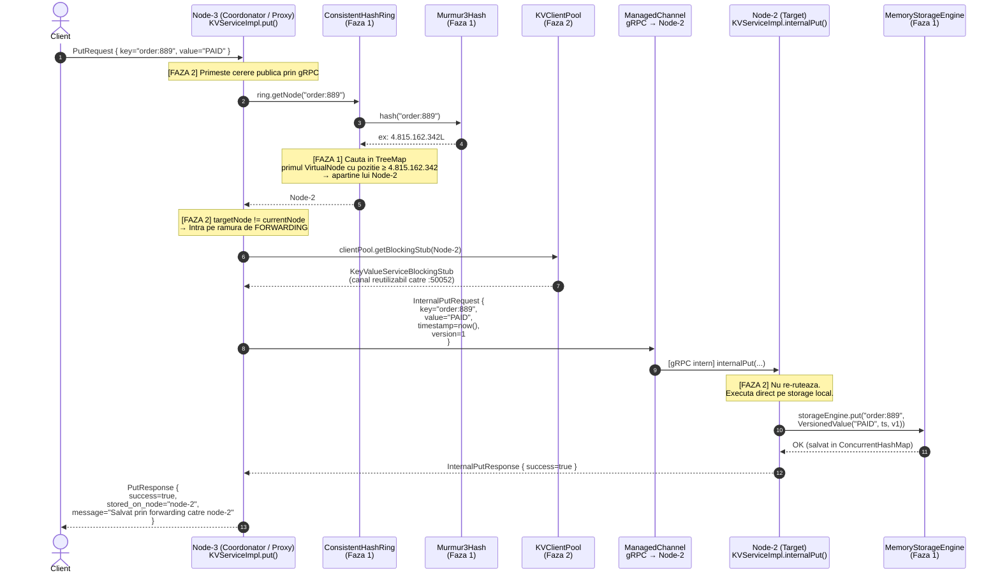

# 🎬 Scenariu Complet: Client PUT → Coordonator (Nod 3) → Target (Nod 2)

> **Cluster:** Node-1 (`:50051`), Node-2 (`:50052`), Node-3 (`:50053`)
> **Operație:** Client scrie cheia `"order:889"` cu valoarea `"PAID"`
> **Nod Coordonator (receptor cerere client):** Node-3
> **Nod Target (responsabil pentru cheie conform inelului):** Node-2

---

## 📐 Premisă: De ce Node-3 este Coordonator și Node-2 este Target?

Clientul se **conectează fizic la Node-3** (de exemplu, prin load balancer sau configurare hardcodată).  
Totuși, conform **inelului de Consistent Hashing**, cheia `"order:889"` **aparține lui Node-2**.  
Acesta este exact scenariul de **forwarding transparent** implementat în Faza 2.

---

## 🗺️ Diagrama Completă a Scenariului



---

## 📋 Pas cu Pas: Ce Concept și Funcție se Activează

### Pasul 1 — Clientul trimite cererea către Node-3

```
Client → Node-3:50053
gRPC call: Put(PutRequest { key="order:889", value="PAID" })
```

**Concepte activate:**
- **gRPC** (Faza 2): Protocol de comunicare binară peste HTTP/2, definit în [`kvstore.proto`](file:///Users/rarescusma/Desktop/Pr/src/main/proto/kvstore.proto)
- **`KeyValueService.Put`** (Faza 2): RPC-ul public expus clientului externi, implementat în [`KVServiceImpl.put()`](file:///Users/rarescusma/Desktop/Pr/src/main/java/ro/distributed/kv/network/KVServiceImpl.java#L46-L102)
- **`StreamObserver<PutResponse>`** (Faza 2): Pattern-ul asincron gRPC pentru răspuns

---

### Pasul 2 — Node-3 consultă inelul de Consistent Hashing

```java
// KVServiceImpl.java, linia 52
Node targetNode = ring.getNode("order:889");
```

**Concepte activate (FAZA 1):**

#### 2a. `Murmur3Hash.hash("order:889")`
- **Clasă:** [`Murmur3Hash`](file:///Users/rarescusma/Desktop/Pr/src/main/java/ro/distributed/kv/core/Murmur3Hash.java)
- Calculează hash-ul pe 64 de biți al cheii: ex. `4.815.162.342L`
- Folosește `Hashing.murmur3_128(seed).hashString(key, UTF_8).asLong()`
- **De ce nu `String.hashCode()`?** Doar 32-bit, dispersie slabă, risc de coliziune pe inel.

#### 2b. `ConsistentHashRing.getNode("order:889")`
- **Clasă:** [`ConsistentHashRing`](file:///Users/rarescusma/Desktop/Pr/src/main/java/ro/distributed/kv/core/ConsistentHashRing.java)
- Internă: **`TreeMap<Long, VirtualNode> ring`** (Red-Black Tree, $O(\log K)$ căutare)
- Apelează `ring.ceilingEntry(keyHash)` → găsește primul `VirtualNode` cu poziție ≥ hash-ul cheii
- Dacă nu există (wrap-around), apelează `ring.firstEntry()` → primul nod din inel
- Returnează `vnode.getPhysicalNode()` → **Node-2**
- **Concurență:** Accesul este protejat de `readLock` (din `ReentrantReadWriteLock`), permițând citiri paralele

#### 2c. `VirtualNode.getPhysicalNode()`
- **Clasă:** [`VirtualNode`](file:///Users/rarescusma/Desktop/Pr/src/main/java/ro/distributed/kv/core/VirtualNode.java)
- Fiecare VirtualNode știe care este nodul fizic **Node-2** din care provine (ex. token `"node-2#vnode-77"`)

---

### Pasul 3 — Node-3 detectează că NU este nodul responsabil

```java
// KVServiceImpl.java, linia 61
if (targetNode.equals(currentNode)) { ... }
else {
    // FORWARDING - Nodul 3 devine Coordonator/Proxy transparent
}
```

**Concepte activate:**
- **`Node.equals()`** (Faza 1): Comparație bazată strict pe câmpul `id` (nu host/port). Două obiecte `Node` cu `id="node-2"` sunt identice.
- **Pattern Coordonator/Proxy** (Faza 2): Node-3 nu refuză cererea. O preia și o transmite mai departe, transparent față de client.

---

### Pasul 4 — Node-3 construiește `InternalPutRequest` și deschide canalul gRPC

```java
// KVServiceImpl.java, linia 78-86
InternalPutRequest forwardReq = InternalPutRequest.newBuilder()
        .setKey(key)
        .setValue(request.getValue())
        .setTimestamp(timestamp)   // ← timestamp generat de Coordonator!
        .setVersion(version)       // ← version = 1L
        .build();

InternalPutResponse internalResp = clientPool.getBlockingStub(targetNode)
        .internalPut(forwardReq);
```

**Concepte activate (FAZA 2):**

#### 4a. `InternalPutRequest` (mesaj intern protobuf)
- **Proto:** [`kvstore.proto`](file:///Users/rarescusma/Desktop/Pr/src/main/proto/kvstore.proto) — linia 57-62
- **Diferența față de `PutRequest`:** Conține `timestamp` și `version` explicit, permițând reconcilierea conflictelor de scriere (Last-Write-Wins) în replicare.

#### 4b. `KVClientPool.getBlockingStub(Node-2)`
- **Clasă:** [`KVClientPool`](file:///Users/rarescusma/Desktop/Pr/src/main/java/ro/distributed/kv/network/KVClientPool.java)
- Apelează `channels.computeIfAbsent(nodeId, ...)` → reutilizează sau creează un `ManagedChannel` TCP către `192.168.x.x:50052`
- Wrapping în `KeyValueServiceBlockingStub` cu deadline de **3 secunde** (timeout implicit)
- **De ce pool de canale?** Conexiunile TCP/gRPC sunt costisitoare (handshake, TLS). Reutilizarea lor reduce latența de la ~100ms la <1ms.

#### 4c. `ManagedChannel` (gRPC)
- Canal TCP persistent, multiplexat (HTTP/2) către Node-2
- Serializarea automată a obiectului `InternalPutRequest` în format **Protocol Buffers** (binar, ~3x mai compact decât JSON)

---

### Pasul 5 — Node-2 primește `internalPut()` și salvează local

```java
// KVServiceImpl.java, linia 220-236
public void internalPut(InternalPutRequest request, ...) {
    // Nu consulta inelul! Executa direct local.
    storageEngine.put(key, new VersionedValue(data, timestamp, version));
    ...
}
```

**Concepte activate (FAZA 1 + FAZA 2):**

#### 5a. Fără re-rutare!
- **Design critic (Faza 2):** `internalPut` nu apelează `ring.getNode()`. Evită bucle infinite de forwarding (Node-2 ar forța tot spre Node-2, infinit).

#### 5b. `VersionedValue` (Faza 1)
- **Clasă:** [`VersionedValue`](file:///Users/rarescusma/Desktop/Pr/src/main/java/ro/distributed/kv/storage/VersionedValue.java)
- Împachetează: `byte[] data = "PAID".getBytes()`, `timestamp = <setat de Node-3>`, `version = 1L`
- Copii defensive pe `byte[]` → protecție contra mutabilității externe

#### 5c. `MemoryStorageEngine.put()` (Faza 1)
- **Clasă:** [`MemoryStorageEngine`](file:///Users/rarescusma/Desktop/Pr/src/main/java/ro/distributed/kv/storage/MemoryStorageEngine.java)
- Apelează `store.put(key, value)` pe un **`ConcurrentHashMap`**
- Thread-safe prin lock-striping intern (nu blochează întregul tabel)
- **Alternativa mai sigură** (anti-conflicte): `putIfNewer()` folosind `compute()` atomic → respinge scrierile cu timestamp mai vechi

---

### Pasul 6 — Răspunsul se întoarce în cascadă către client

```
Node-2 → Node-3: InternalPutResponse { success=true }
Node-3 → Client: PutResponse {
    success=true,
    stored_on_node="node-2",
    message="Salvat prin forwarding catre node-2"
}
```

**Concepte activate:**
- **`StreamObserver.onNext()` + `onCompleted()`** (Faza 2): Pattern gRPC unary de finalizare a răspunsului
- **`PutResponse.stored_on_node`** (Faza 2): Clientul știe pe ce nod fizic a aterizat cheia, util pentru debugging

---

## 🗂️ Tabel Rezumativ: Faza 1 vs Faza 2

| Pas | Acțiune | Clasă/Funcție | Faza |
|-----|---------|----------------|------|
| 1 | Client trimite cererea | `KVServiceImpl.put()` | **Faza 2** |
| 2a | Calculul hash-ului cheii | `Murmur3Hash.hash()` | **Faza 1** |
| 2b | Găsirea nodului responsabil | `ConsistentHashRing.getNode()` → `TreeMap.ceilingEntry()` | **Faza 1** |
| 2c | Extragerea nodului fizic | `VirtualNode.getPhysicalNode()` | **Faza 1** |
| 3 | Detecția că Node-3 ≠ Node-2 | `Node.equals()` | **Faza 1** |
| 4a | Construirea mesajului intern | `InternalPutRequest` (protobuf) | **Faza 2** |
| 4b | Obținerea canalului gRPC | `KVClientPool.getBlockingStub()` | **Faza 2** |
| 4c | Transmiterea binară | `ManagedChannel` gRPC / HTTP/2 | **Faza 2** |
| 5a | Executare directă (fără re-rutare) | `KVServiceImpl.internalPut()` | **Faza 2** |
| 5b | Ambalarea valorii cu versiune | `new VersionedValue(data, ts, v)` | **Faza 1** |
| 5c | Salvarea atomică în RAM | `MemoryStorageEngine.put()` | **Faza 1** |
| 6 | Returnarea răspunsului | `StreamObserver.onNext/onCompleted` | **Faza 2** |

---

## 💡 Puncte Cheie de Înțeles

> [!IMPORTANT]
> **Node-3 nu stochează nimic.** El acționează exclusiv ca un **proxy transparent**: primește cererea publică, consultă inelul (Faza 1) și o redirecționează intern (Faza 2) spre Node-2.

> [!NOTE]
> **Timestamp-ul este setat de Node-3** (Coordonator), nu de client. Asta asigură că toate replicile aceleiași scrieri primesc **exact același timestamp**, indiferent de latența rețelei între noduri — fundament pentru Last-Write-Wins în Faza 3.

> [!TIP]
> **`KVClientPool` reutilizează canalele TCP.** A doua cerere de la Node-3 spre Node-2 va folosi **același `ManagedChannel`** deja deschis, fără overhead de reconectare. Aceasta este diferența dintre o latență de 1ms vs 100ms pentru forwarding-ul intern.

> [!WARNING]
> **`internalPut` NU consultă inelul.** Dacă ar face-o, ar crea o buclă infinită: Node-2 ar afla că cheia aparține tot lui Node-2, ar apela `internalPut` pe el însuși, și tot așa. Separarea clară a API-ului public de cel intern este esențială.
